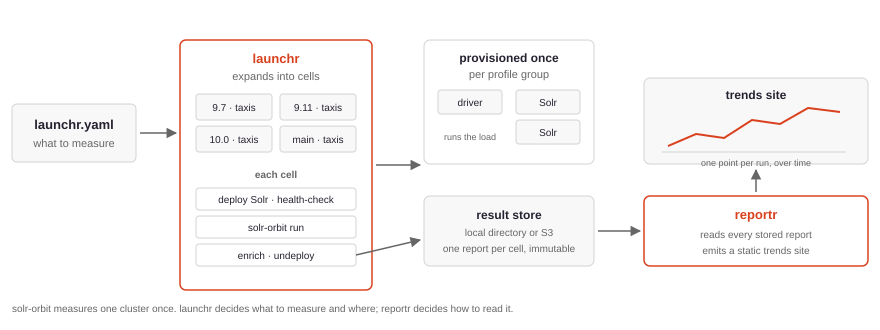

# How Continuous Benchmarking Works

This page describes the model the tools share, independently of where the benchmark runs. Everything here applies equally to a laptop and to a cloud provider.



## Cells and groups

A **cell** is one benchmark: one Solr version, one workload, one test procedure, one hardware profile, one cluster config. `launchr run` expands the configuration into every combination and executes them in order.

A **provisioning group** is the set of cells that can share machines. Infrastructure is created once per group and reused across its cells, because provisioning is slow and identical hardware makes the results comparable. Within a cell:

1. Deploy the requested Solr version.
2. Health-check every node, and wait for the cluster to report the expected number of live nodes.
3. Resolve the version's position on the time axis.
4. Invoke `solr-orbit run --pipeline=benchmark-only` against the live cluster.
5. Enrich the resulting report and store it.
6. Undeploy Solr, leaving no index behind for the next cell.

A failed cell is recorded as data, not as an outage: its report is stored with `"status": "failed"` alongside the Solr and container logs, and the next cell proceeds. Teardown runs even when a cell raises.

{: .note }
`launchr` does **not** use Solr Orbit's `from-distribution`, `from-sources` or `docker` provisioning pipelines. It owns the Solr lifecycle itself and always runs `--pipeline=benchmark-only` against a cluster it has already started. The reason is step 2: `launchr` needs a *live* cluster between deployment and execution so it can read `/solr/admin/info/system` for the exact build under test. With Solr Orbit's own pipelines the cluster is created and destroyed inside the `solr-orbit` process, leaving no window in which to ask.

## The enriched report

Each cell produces Solr Orbit's ordinary `test_run.json`, unchanged byte for byte, with one extra top-level `launchr` key added beside it. Keeping the original intact means `solr-orbit compare` and any existing tooling still work on a stored report.

The added block records what the report alone cannot say:

| Field | Why it is there |
|-------|-----------------|
| `run_id`, `session_id`, `cell_id` | Identifies this cell, and which invocation it belonged to. |
| `status`, `error` | Whether the benchmark succeeded, and why not. |
| `solr.version`, `solr.commit` | The build the cluster actually reported, not the one requested. |
| `solr.version_timestamp`, `version_timestamp_source` | Where this point sits on the chart's time axis, and how that was determined. |
| `infra` | Provider, region, instance types, volumes, applied host tuning. |
| `cluster_config` | The heap, GC and shard settings that were applied, and the environment they became. |
| `workload` | Name, test procedure, repository and revision. |

## Storage

Reports are written through a storage backend. Two ship today — a local directory and S3 — and both use an identical layout:

```
runs/<workload>/<date>/<run-id>/results.json
runs/<workload>/<date>/<run-id>/logs/        # failed cells only
summaries/<date>-<session-id>.yaml
infra/<stack-id>/                            # provisioning ledger
```

Because the layout does not vary, `reportr` builds the same site from either, and moving from a laptop to shared storage is a one-line configuration change.

Stored reports are **immutable**: writing to a path that already exists fails rather than overwriting. A re-run gets a new run ID. Silently replacing a result is a data-integrity problem that is almost impossible to notice afterwards.

## The time axis

A trend chart needs each run placed on a timeline, and the obvious choice — when the benchmark ran — is the wrong one. Benchmarking Solr 9.0 today would place a two-year-old release at today's date and flatten the history.

`launchr` resolves the position in this order, and records which source answered:

1. **`apache-releases`** — the release date from the Apache release list, for a released version.
2. **`info-system`** — the build timestamp the cluster reports in `solr-impl-version`.
3. **`container-image`** — when the container image was built. In practice this is the only source a nightly has: a SNAPSHOT build is in no release list and reports no build timestamp.

If none of them can answer, the cell fails rather than guessing. A point in the wrong place on a trend chart is worse than a missing point.

## Cluster configuration

`launchr.yaml` has a `cluster_configs:` block that sets heap, garbage collector, JVM options, shard count and replication factor per cell.

{: .important }
This is **not** Solr Orbit's `--cluster-config`, despite the similar name. Solr Orbit only loads a cluster-config for its local pipelines; under `--pipeline=benchmark-only` it records the names in the report without applying anything. Passing them would therefore put a claim in the report that nothing acted on. `launchr` applies the settings itself — heap, GC and options become environment variables on the Solr process, while shards and replicas become workload parameters — and records exactly what it applied. The consequence is that Solr Orbit's [preset catalogue](../../cluster-config/) of named configs such as `8gheap` and `parallelgc` is not available in this mode, which is a pity: the presets are good, and they are unreachable here.

## What runs where

The load driver does not share a machine with Solr in any serious configuration. A driver competing with Solr for CPU makes its own overhead part of what the benchmark measures, and the effect is not constant across Solr versions.

Local runs necessarily violate this, which is why their reports record `infra.provider: "local"`. They are for developing the pipeline, not for publishing numbers — see [Performance Testing Best Practices](../optimizing-benchmarks/best-practices.html).