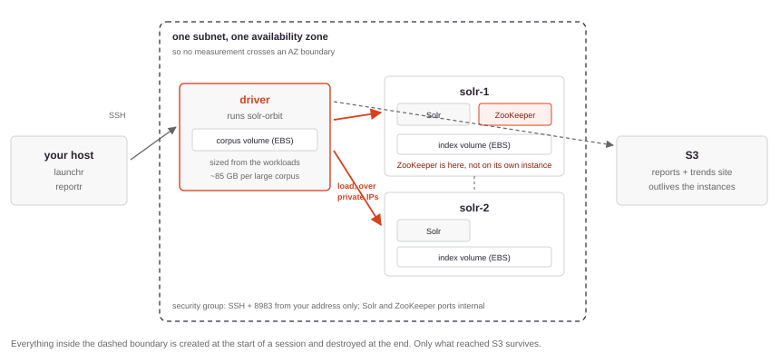

# Provider: AWS

The `ec2` provisioning strategy creates dedicated instances for a session, runs the matrix on them, and destroys them afterwards. It is the first configuration whose results are worth publishing, because it is the first in which the load driver does not share a machine with Solr.

`examples/launchr-ec2.yaml` is a complete, commented starting point. This page explains what it does and what you must change.

{: .warning }
This spends money. Three instances for the length of a session, plus EBS. Read [Cost](#cost) and set up [teardown](#teardown) before the first run, not after.

## What gets provisioned



One driver instance and *N* Solr instances, all in a single subnet so that no measurement crosses an availability-zone boundary — inter-AZ latency would otherwise sit inside every replica operation.

{: .note }
**ZooKeeper runs as a container on the first Solr node, not on an instance of its own.** Putting it on the driver would keep the Solr nodes byte-for-byte identical, which is tidier — but the driver is the machine under sustained load during indexing, and a starved ZooKeeper there means session timeouts and a lost run. ZooKeeper's cost during a steady-state benchmark is near zero, because SolrCloud clients cache cluster state rather than consulting it per request. The asymmetry is recorded in each report under `infra.deployment.zookeeper`.

### Instance sizing

```yaml
options:
  instance_type: m7i.2xlarge          # each Solr node
  driver_instance_type: m7i.2xlarge   # the load driver
```

The driver is deliberately not smaller than the Solr nodes. On a full corpus it reads tens of gigabytes of JSON, parses it and sends every document; if it saturates first, every Solr version returns the same number and the benchmark cannot answer the question it exists to ask.

### Storage

```yaml
options:
  data_volume:                        # the index, on each Solr node
    mode: ebs                         # 'ebs' (default) or 'root'
    size_gb: 500
    type: gp3
    iops: 16000
    throughput_mbps: 1000
  driver_data_volume:                 # the corpus cache, on the driver
    mode: ebs
    size_gb: auto
```

The index goes on a dedicated volume rather than the instance root. A root volume sits at the gp3 baseline of 3000 IOPS and 125 MB/s, and a merge-heavy indexing run against that measures the disk rather than Solr.

`size_gb: auto` reads the byte counts the configured workloads declare and doubles them — Solr Orbit keeps both the compressed archive and the decompressed file, so `nyc_taxis` alone needs about 85 GB. An explicit number overrides it.

### Host tuning

```yaml
options:
  host_tuning:
    transparent_hugepages: never
    swappiness: 1
    cpu_governor: performance
```

Applied before Solr starts, then read back over SSH so the report records what the kernel was actually doing rather than what was requested. These are chosen to remove variance, not to maximise a number. Set any value to `null` to leave the machine alone.

## Credentials

Two separate AWS identities, and conflating them is the mistake this layout prevents:

```yaml
storage:
  options:
    profile: solr-orbit               # results bucket only

provisioning_profiles:
  ec2-2node:
    options:
      aws_profile: benchmark-ec2      # EC2 only
```

| Identity | Should be able to | Should not be able to |
|----------|-------------------|-----------------------|
| Storage profile | Read and write one bucket | Touch EC2, or any other bucket |
| Provisioning profile | Create and destroy EC2 resources | Read or write the results bucket |

A good shape for the provisioning identity is a user with no standing permissions at all beyond `sts:AssumeRole` into a role that holds the EC2 rights. A leaked key is then worth very little, and re-scoping means editing the role rather than rotating credentials.

Both values are *profile names*, resolved from `~/.aws/config` and `~/.aws/credentials`. Neither is a secret, and `launchr` rejects a configuration file containing anything that looks like one.

The bucket's region and the provisioning region should match, or every result crosses a region boundary on its way to storage.

## Network access

By default the security group admits SSH and the Solr admin port from **one address**: the public address of the machine starting the run, detected at that moment.

{: .warning }
That address is a snapshot of something that changes. A DHCP renewal, a VPN toggle or moving between networks silently stops the rule matching, and a multi-hour run then dies at the transport layer with nothing wrong with the benchmark. Name stable ranges alongside it:

```yaml
options:
  extra_ssh_cidrs:
    - 203.0.113.0/24      # office
    - 198.51.100.0/24     # VPN pool
```

Solr's own ports are reachable only from inside the security group, so a benchmark instance with a public address is not a public Solr.

## Reaching a running cluster

`launchr` generates a key pair per session, writes the private key with mode `0600` for the life of the run, and deletes it at teardown — so this works only while a run is in flight:

```bash
KEY=$(ls -t "${TMPDIR:-/tmp}"/launchr-session-*/*.pem | head -1)
ssh -i "$KEY" ec2-user@<driver-address>      # the address is in launchr's log
```

| What | Where, on the driver |
|------|----------------------|
| Live Solr Orbit log | `~/.solr-orbit/logs/benchmark.log` |
| Finished reports | `~/.solr-orbit/benchmarks/test-runs/<test-run-id>/` |
| Corpora | the mounted corpus volume |

The Solr nodes take the same key and user; `docker logs launchr-solr` and, on the first node, `docker logs launchr-zk`.

## Cost

Three `m7i.2xlarge` instances are roughly **$1.50 per hour in `eu-north-1`** while a session is in flight, and nothing when it is not. EBS is charged separately, and provisioned IOPS and throughput above the gp3 baseline are billed on top of capacity.

Prices vary by region and change over time — treat that figure as an order of magnitude and check current pricing. The practical number to watch is session *duration*: a full-corpus matrix runs for hours, and the first cell of a session also pays a one-off corpus download and decompression.

Tag everything so the spend is attributable. `launchr` applies its own tags plus `project`, which lets cost reporting separate benchmarking from everything else.

## Teardown

A session tears down in a `finally` block, so an ordinary failure still destroys its instances. A process that is killed outright never reaches it.

```bash
launchr teardown --dry-run                  # what would be reclaimed
launchr teardown --older-than 6h            # reclaim it
```

Reclamation uses two independent sources, each covering the other's blind spot:

- **Cloud tags** are authoritative about what exists right now — but only in the account, region and credentials in front of you.
- **The ledger** in the result store records what was ever created and never released. It travels with the results, so a leak from someone's laptop is visible to the nightly, and it names the region to go and look in.

A region whose sweep fails leaves its entries open rather than being marked clean, because a failed API call proves nothing about what is running.

See [Scheduling Nightly Runs](scheduling-nightly-runs.html) for running this on a timer, and why `--older-than` is mandatory there.
